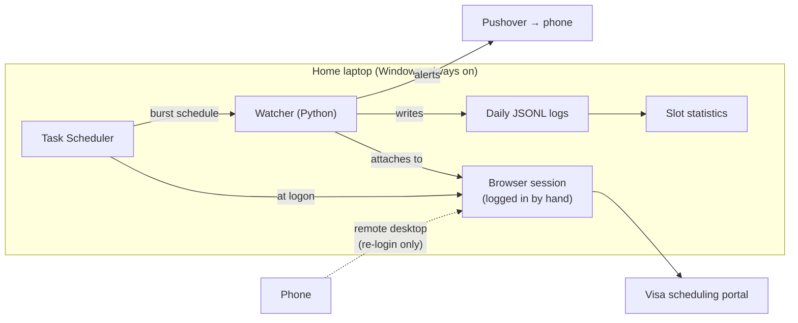
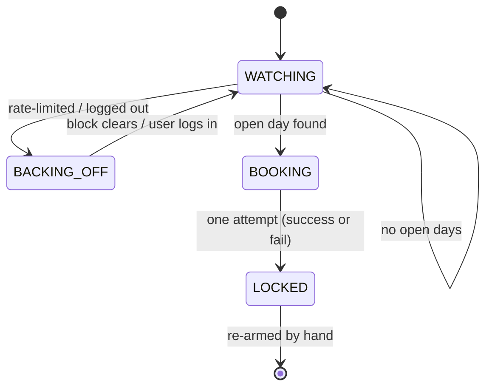

# Visa Appointment Slot Monitor

An always-on watcher that monitors U.S. visa appointment availability across multiple consulates in India and books the first open slot automatically. Openings appear and disappear within seconds, so the system is built around **reaction speed**, **reliability while unattended**, and **not getting the account banned**.

> 🔒 **Source code is private.** This repo documents the project's design, decisions and results. I'm happy to walk through the code in an interview.

---

## The problem

Visa interview slots at U.S. consulates in India are scarce. Cancellations show up at random times and are usually taken within seconds. Checking by hand around the clock isn't realistic, and the scheduling portal sits behind strict bot protection and rate limiting, so a naive scraper either gets blocked or gets the account banned.

## What it does

- **Monitors several consulates** on a configurable schedule and spots an open day as soon as the portal reports one.
- **Books automatically** the moment a slot appears, with no human step in between, because a slot can be gone before anyone could tap "confirm."
- **Books at most once.** After any booking attempt, successful or not, the watcher locks itself and won't fire again until a person re-arms it. A bug can never cause a second, unwanted booking.
- **Sends push alerts to a phone** (Pushover). Emergency priority for "slot found," "booked," "booking failed," and "log in needed," which overrides silent mode and repeats until acknowledged.
- **Runs unattended** on a home laptop, with remote re-login from a phone when the session expires.
- **Keeps structured logs** (daily JSON Lines) and includes an analysis script that reports which consulates open slots, at what hour, and how long they stay open.
- **Has a phone-side companion**: an iOS Shortcuts version of the same check-and-book logic for manual, on-the-go checks, with its own offline test suite.

## Architecture

| Component | Role |
|---|---|
| **Browser session** | A real browser that the user logs into by hand. It holds the authenticated session. |
| **Watcher** | Attaches to that session to check availability and fire the booking request. |
| **Task Scheduler** | Starts the browser at logon and runs the watcher on a schedule. Each run is one short check, so a crash can't take down later runs. |
| **Pushover** | Delivers tiered push notifications to the phone. |
| **Remote desktop** | Lets the user log in again from a phone when the session expires. |

### Watcher state machine

## Engineering highlights

- **Treating every request as a cost.** The portal rate-limits aggressively. The watcher uses jitter, exponential backoff (2 min → 30 min cap), and never retries into an error. A "burst" schedule concentrates checks in the minutes around when slots tend to appear instead of polling evenly all day, which gets better coverage from fewer requests.
- **Choosing to respect the portal's protections rather than defeat them.** Login is always done by hand, and the project deliberately avoids CAPTCHA solvers, proxy/IP rotation, and fingerprint spoofing. Several approaches were tested and documented before settling on the one design that worked within those limits.
- **Data-driven scheduling.** Weeks of logs fed a stats script that showed when and where slots open, and the schedule was tuned from that data.
- **Safe-by-default tooling.** A dry-run mode does everything except the booking call. Scheduler setup scripts are dry-run unless explicitly told to go live. Secrets live only in a gitignored `.env`.
- **Documented decisions.** A written decision log and a short learning guide explain every architectural choice: where to host, how to authenticate, how to schedule, and how to alert.

## Real-world run

These are actual alerts from the system running unattended over several days (Sep 29 – Oct 1, 2026):

They show each part of the pipeline working end to end:

- **Session monitoring:** the watcher noticed when the login expired, paused slot checks, and asked for a re-login. It confirmed when the session was healthy again and resumed on its own.
- **Slot detection → booking → lock:** on Sep 30 it detected an open appointment day, fired the booking request immediately, reported the portal's response, and locked itself as designed.

That booking attempt was **rejected by the portal** (error `PSE0601`). The pipeline reached the booking step on its own within seconds of the slot appearing, and the one-shot safety lock prevented any repeat attempts.

## Tech stack

| Area | Tools |
|---|---|
| Language | Python 3.12, JavaScript |
| Browser automation | Playwright (attach to an existing Chrome session via CDP) |
| Scheduling | Windows Task Scheduler, PowerShell |
| Notifications | Pushover API |
| Mobile | iOS Shortcuts (JavaScript), Node.js offline tests |
| Logging and analysis | JSON Lines, custom Python stats script |
| Remote ops | Chrome Remote Desktop |

## What I learned

- Designing for a hostile, rate-limited environment, where the cheapest request is the one you don't make
- Building safety rails for automation that acts without a human in the loop
- Running and monitoring a long-lived process on consumer hardware
- Using a project's own logs to tune its behavior

---

*Source code is available on request for interview purposes.*
